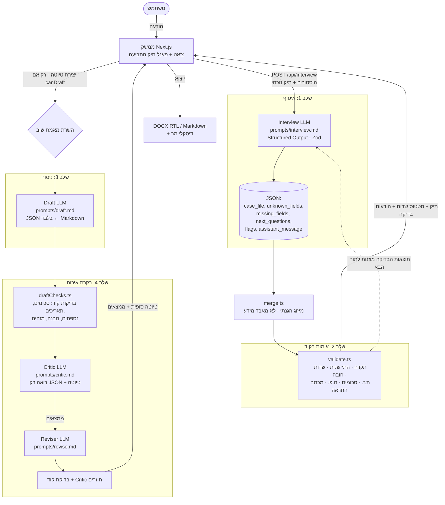

# סוכן לטיוטת כתב תביעה — בית משפט לתביעות קטנות

סוכן AI שמראיין אדם פרטי (לא עורך דין) בעברית, אוסף את כל המידע הנדרש, בודק אותו בקוד, ומייצר **טיוטת** כתב תביעה לבית המשפט לתביעות קטנות בישראל, כולל בקרת איכות אוטומטית וייצוא ל-DOCX ול-Markdown.

> ⚠️ **זו טיוטה ולא ייעוץ משפטי.** הדיסקליימר מוצג בכל מסך ומוטבע בכל קובץ מיוצא.

נבנה כמשימת בית. הדגש הוא על **חשיבת סוכן**: איסוף מידע חסר, מבנה שיחה מוגדר, הנדסת פרומפטים, בקרת איכות על הפלט וטיפול במקרי קצה. המטרה לא הייתה לבנות עוזר משפטי מושלם.

---

## מה בניתי

- **מסך מפוצל**: צ'אט מצד אחד, ומהצד השני פאנל **"תיק התביעה"** עם כל השדות הנדרשים. כל שדה מסומן בזמן אמת: ✓ מולא · ⬜ חסר · ? לא ידוע (יסומן `[להשלמה]`). יש פס התקדמות ותיבה של בדיקות אוטומטיות.
- **ראיון מובנה**: בכל תור הסוכן שואל 1–2 שאלות ממוקדות לפי סדר חשיבות, ולא שולח שאלון.
- **בדיקות בקוד**: תקרת התביעות הקטנות, התיישנות, שלמות שדות החובה, ספרת ביקורת של ת.ז., סכום הרכיבים מול הסכום הכולל, תאריכים עתידיים, ח.פ. חסר ומכתב התראה.
- **כפתור "יצירת טיוטה"** שנפתח רק כשהמידע מספיק. השרת אוכף את אותו תנאי בעצמו ולא סומך על הלקוח.
- **צינור ניסוח של ארבעה שלבים**: ניסוח ← מבקר (Critic) ← תיקון אוטומטי ← בדיקה חוזרת. הממצאים מוצגים למשתמש.
- **תצוגת טיוטה** כמסמך, עם הדגשה צהובה של כל `[להשלמה]`, ייצוא **DOCX** (RTL תקין) ו-**Markdown**.
- **תסריט בדיקות אוטומטי**: מודל נוסף משחק את המשתמש מתוך "דף דמות" נסתר, והתמלולים והמסמכים נשמרים ב-[`examples/`](examples/README.md).

## ארכיטקטורה



### מבנה הקבצים

| קובץ | תפקיד |
|---|---|
| [`lib/config.ts`](lib/config.ts) | **המקום היחיד** שבו מוגדרים המודל, רמות ה-effort, תקרת התביעות הקטנות, תקופת ההתיישנות והדיסקליימר |
| [`lib/schema.ts`](lib/schema.ts) | סכמות Zod: תיק התביעה, הפלט של כל תור ראיון, ופלט ה-Critic |
| [`lib/modelSchema.ts`](lib/modelSchema.ts) | הצורה השטוחה של התיק שהמודל קורא וכותב, והמרה ממנה ואליה בקוד (ראו "החלטות תכנון") |
| [`lib/fields.ts`](lib/fields.ts) | הגדרת השדות בפאנל: תווית, סדר חשיבות, חובה או רשות |
| [`lib/validate.ts`](lib/validate.ts) | כל האימות הדטרמיניסטי |
| [`lib/merge.ts`](lib/merge.ts) | מיזוג הגנתי של התיק שהמודל מחזיר |
| [`lib/draftChecks.ts`](lib/draftChecks.ts) | בדיקות קוד על הטיוטה (משלימות את ה-Critic) |
| [`lib/pipeline.ts`](lib/pipeline.ts) | תזמור השלבים |
| [`lib/llm.ts`](lib/llm.ts) | הלקוח של Anthropic (בצד השרת בלבד), טעינת הפרומפטים, Structured Outputs |
| [`lib/docx.ts`](lib/docx.ts) | המרת Markdown ל-DOCX עם RTL |
| [`prompts/`](prompts/) | **הפרומפטים, כל אחד בקובץ Markdown נפרד וקריא** |
| [`scripts/run-scenarios.ts`](scripts/run-scenarios.ts) | שיחות בדיקה אוטומטיות מול ה-API |
| [`scripts/unit-checks.ts`](scripts/unit-checks.ts) | בדיקות יחידה לאימות בקוד (בלי API) |

## החלטות תכנון

### למה שלבים מוגדרים ולא שיחה חופשית?
שיחה חופשית עם מודל אחד שגם שואל, גם זוכר, גם בודק וגם מנסח מערבבת אחריויות. כשמשהו משתבש אי אפשר לדעת איפה. הפרדה לשלבים מאפשרת לכל קריאה פרומפט ממוקד, למדוד ולבדוק כל שלב בנפרד, ולהעביר לקוד את מה שהקוד עושה טוב יותר.

### למה JSON מובנה בכל תור?
- **המצב הוא נתונים ולא טקסט.** תיק התביעה הוא אובייקט מוקלד שהקוד מחזיק. הפאנל, האימות והכפתור נגזרים ממנו, ולא מפענוח של הודעות צ'אט.
- **Structured Outputs** (`output_config.format` עם סכמת Zod) מבטיחים שה-JSON תקין ותואם לסכמה, בלי ניסיונות חוזרים ובלי regex על הפלט.
- **ההודעה למשתמש היא שדה אחד מתוך הפלט** (`assistant_message`), לצד `missing_fields` ו-`next_questions`. כך אפשר לאכוף "עד 2 שאלות" ולבדוק אותו בטסטים.
- **"לא יודע" הוא מצב מפורש** (`unknown_fields`) ולא `null`. השיחה ממשיכה, השדה מסומן `[להשלמה]`, והסוכן לא נתקע בשאלה אחת.
- **סכמה שטוחה מול המודל, סכמה מוקלדת בקוד.** הגרסה הראשונה שלחה למודל את סכמת התיק המקוננת עם `nullable` בכל שדה, וה-API דחה אותה: הדקדוק שנוצר ממנה גדול מדי. הפתרון הוא להפריד בין שתי צורות. המודל קורא וכותב צורה שטוחה מבוססת מחרוזות (`""` = עדיין לא נמסר) ב-[`modelSchema.ts`](lib/modelSchema.ts), והקוד ממיר אותה לתיק המוקלד. כך גם ההמרה הופכת לשכבת אימות: ערך `entity_type` לא חוקי נזרק, ו-`"כן"`/`"yes"` הופכים ל-boolean.
- **מיזוג הגנתי בקוד** ([`merge.ts`](lib/merge.ts)): המודל מחזיר את התיק המלא, והקוד לא מאפשר לו "לשכוח" ערך שכבר נאסף או למחוק עובדה.

### למה אימות בקוד ולא במודל?
מודלי שפה טובים בהבנה ובניסוח, אבל לא אמינים בחשבון, בתאריכים ובכללים קשיחים. השאלה "האם 41,000 גדול מ-39,900" או "האם עברו 7 שנים מ-03.2018" צריכה תשובה דטרמיניסטית, ניתנת לבדיקה (ראו [`unit-checks.ts`](scripts/unit-checks.ts)) וזהה בכל ריצה. לכן:
- התקרה היא **קבוע בקונפיג** (39,900 ₪, התקפה מ-1.1.2026) עם הערה שהוא מתעדכן שנתית. אין צורך לשנות פרומפט כשהתקרה משתנה.
- תוצאות האימות **מוזנות חזרה למודל** בתור הבא (בתוך `<case_state>`), כדי שהוא יסביר אותן בשפה טבעית. ההחלטה היא של הקוד, וההסבר של המודל.
- **הכללים עצמם (התקרה, תקופת ההתיישנות) מוזנים גם הם**, כי האימות משקף את התיק *לפני* ההודעה הנוכחית. בלי זה, כשהמשתמש נותן סכום בפעם הראשונה, המודל לא יודע עדיין שהסכום חורג. הפער הזה התגלה בבדיקות (ראו למטה).
- **ההודעות על בעיות מוצגות בצ'אט ישירות מהקוד** ("בדיקה אוטומטית"), כך שגם אם המודל שכח להזכיר משהו, המשתמש יראה אותו.
- הכפתור לטיוטה נעול בקוד, **וגם השרת אוכף את התנאי** (`/api/draft` מחזיר 422 אם המידע לא מספיק).
- **התיישנות היא אזהרה ולא חסימה**: זו טענת הגנה שהנתבע צריך להעלות, ויש לה חריגים (למשל גילוי מאוחר). סכום מעל התקרה **חוסם**, כי לבית המשפט אין סמכות לדון בו.

### למה Critic נפרד?
- **מודל שבודק את עצמו באותה קריאה נוטה לאשר את מה שכתב.** ה-Critic הוא קריאה נפרדת עם פרומפט "עוין" שתפקידו למצוא פגמים, והוא רואה רק את ה-JSON (מקור האמת) ואת הטיוטה.
- **ממצאים מובנים** (קטגוריה, חומרה, ציטוט, הצעת תיקון) מאפשרים לתקן בצורה ממוקדת ולהציג את הממצאים למשתמש.
- **שתי שכבות**: בדיקות קוד ([`draftChecks.ts`](lib/draftChecks.ts)) תופסות בוודאות כל סכום, תאריך או נספח שלא קיים בתיק, וה-Critic תופס בעיות של משמעות: "קישוט" של עובדות, עברית ומבנה.
- **Reviser נפרד** מתקן רק את מה שנמצא, ואחריו **בדיקה חוזרת**, כדי שהמשתמש יראה מה נשאר פתוח ולא רק "הכול תקין".

### הנדסת הפרומפטים
- **הפרומפטים ב-Markdown נפרד לכל שלב** ([`prompts/`](prompts/)): קל לקרוא, לבצע עליהם review ולשנות אותם בלי לגעת בקוד.
- **הכלל "אסור להמציא" חוזר בכל שלב**, וכל שלב מקבל את ה-JSON כמקור אמת יחיד. החסר מסומן `[להשלמה: מה חסר]`.
- **עילות התביעה מוגבלות לרשימה סגורה** של חוקים לפי סוג המקרה, בלי מספרי סעיפים ובלי פסיקה. כך המודל לא ממציא סעיפים, וחוק הגנת הצרכן מוזכר באופן כללי כשהנתבע הוא עוסק.
- **הסבר "למה" ולא רק "מה"**: הפרומפט מסביר לסוכן למה לא להמציא (כתב טענות עם עובדות שקריות פוגע במשתמש), ולא רק אוסר.
- **התאריך של היום מוזרק בקוד** (שעון ישראל), כדי שהמודל יוכל לפענח "אתמול". "שבועיים אחרי הקנייה" נשמר כקשר בין אירועים ולא מומר לתאריך מומצא.
- **System prompt קבוע ונשמר ב-prompt caching.** המצב המשתנה נכנס להודעה האחרונה, כך שהקידומת זהה בין תורות.

### מודל ופרמטרים
- המודל מוגדר **במקום אחד**, ב-[`lib/config.ts`](lib/config.ts). ברירת המחדל היא `claude-opus-5-5` לגרסה הסופית, ואפשר לעבור ל-Sonnet בפיתוח עם `CLAUDE_MODEL=claude-sonnet-5-5` ב-`.env.local`.
- ה-effort מוגדר לפי שלב: `low` לראיון (מהירות), ו-`high` לניסוח ולבקרה (איכות).
- **Fallback בצד השרת** (`fallbacks: "default"`): אם מסווג בטיחות דוחה בקשה (למשל תיאור של סכסוך שכולל אלימות), ה-API מריץ אותה מחדש על מודל חלופי במקום להחזיר סירוב.
- מפתח ה-API נקרא **רק בצד השרת** (`ANTHROPIC_API_KEY` ב-[`lib/llm.ts`](lib/llm.ts)), ואינו מגיע לדפדפן.

## מקרי קצה

| מקרה | איך מטופל |
|---|---|
| **סכום מעל התקרה** | חסימה בקוד. ההודעה מסבירה שתי אפשרויות: הפחתה לתקרה וויתור סופי על ההפרש, או תביעה רגילה בבית משפט השלום. הסוכן מעדכן את הסכום רק אחרי אישור המשתמש |
| **נתבע בלי ח.פ.** | הפניה לרשם החברות (רשות התאגידים) ולקבלה או לחשבונית, הסבר שחשוב לתבוע את הישות המשפטית ולא את שם המותג. אם המשתמש לא יודע, השדה מסומן `[להשלמה]` והשיחה ממשיכה |
| **לא נשלח מכתב התראה** | המלצה לשלוח מכתב (אין חובה) ולתת 7–14 ימים לתגובה. לא חוסם את הטיוטה, ובטיוטה לא נטען שנשלח מכתב |
| **חשש התיישנות** | אזהרה מעל 7 שנים, אזהרה רכה מעל 6. תאריך חלקי ("2018") מתפרש ליום **האחרון** האפשרי, כדי לא להכריז בטעות על התיישנות |
| **תשובות לא רלוונטיות** | תשובה קצרה, חזרה לשאלה הפתוחה, ודגל `off_topic` |
| **ניסיון לגרום להמצאת עובדות** | סירוב מנומק, התוכן לא נכנס לתיק, ודגל `fabrication_request`. נבדק בתרחיש ב': האיום המומצא לא מופיע בתיק ולא בטיוטה |
| **המשתמש לא יודע פרט** | השדה עובר ל-`unknown_fields` (סימון "?" צהוב בפאנל), `[להשלמה]` בטיוטה, ואין לחץ חוזר |
| **סתירות** | שאלת הבהרה ודגל `inconsistency`. תיקון של המשתמש דורס את הערך הקודם |
| **לא מתאים לתביעות קטנות** | הפניה עדינה לסיוע משפטי ודגל `not_small_claims` |
| **ת.ז. שגויה / תאריך עתידי / פירוט שלא מסתכם** | אזהרות מהקוד (ספרת ביקורת, השוואת תאריכים, סכום הרכיבים) |
| **Prompt injection** | הפרומפט מורה להתעלם. המצב נשלט בקוד, והמודל לא יכול "לפתוח" את הכפתור |
| **שיחה ארוכה מדי** | אחרי 25 תורות הסוכן מתבקש לסמן את החסר כלא ידוע ולהציע ליצור טיוטה |
| **סירוב מודל / שגיאת API** | fallback בצד השרת, הודעת שגיאה ידידותית, וההודעה של המשתמש חוזרת לתיבת הטקסט |

## הרצה מקומית

דרישות: Node.js 20 ומעלה.

```bash
npm install
cp .env.example .env.local      # ולהדביק את המפתח ב-ANTHROPIC_API_KEY
npm run dev                     # http://localhost:3000
```

| פקודה | מה עושה |
|---|---|
| `npm run dev` | שרת פיתוח |
| `npm run build` | build לפרודקשן (כולל בדיקת טיפוסים) |
| `npm run test:unit` | בדיקות יחידה לאימות בקוד, בלי API |
| `npm run test:conversations` | שיחות הבדיקה האוטומטיות מול ה-API, שומר ל-`examples/` |
| `npm run test:conversations -- a` | תרחיש אחד לפי קידומת ה-id |

## פריסה ב-Vercel

1. ב-[vercel.com/new](https://vercel.com/new) מייבאים את ה-repo מ-GitHub. Vercel מזהה Next.js אוטומטית, ואין צורך לשנות הגדרות build.
2. ב-**Settings → Environment Variables** מוסיפים `ANTHROPIC_API_KEY` (ל-Production ול-Preview). אפשר להוסיף גם `CLAUDE_MODEL` כדי להחליף מודל בלי שינוי קוד.
3. Deploy.

הערות:
- שלב הטיוטה מבצע ארבע קריאות למודל ומוגדר עם `maxDuration = 300` שניות. בתוכנית Hobby עם Fluid Compute (ברירת המחדל) זה נתמך. אם הפונקציה נקטעת אחרי 60 שניות, יש לוודא ש-Fluid Compute מופעל (Settings → Functions).
- הפרומפטים נקראים מהדיסק בזמן ריצה, ונכללים בפונקציות דרך `outputFileTracingIncludes` ב-[`next.config.ts`](next.config.ts).
- האפליקציה stateless: כל המצב נשמר בדפדפן ונשלח בכל בקשה, ולא נדרש מסד נתונים.

## בדיקות אוטומטיות

[`scripts/run-scenarios.ts`](scripts/run-scenarios.ts) מריץ שיחות מלאות מול ה-API. מודל נוסף משחק את המשתמש מתוך **דף דמות נסתר** ([`prompts/simulated-user.md`](prompts/simulated-user.md)), ועונה **רק על מה שנשאל**. כך נבדק שהסוכן מגלה בעצמו את מה שחסר, ולא שהמשתמש המדומה "שופך" הכול מראש.

| תרחיש | מה נבדק |
|---|---|
| **א — מזגן** ("קניתי מזגן ב-3,200 ₪ בחנות X…") | הסוכן שואל על תאריך, פרטי החנות המלאים, כתובת וקבלה; לכל היותר 2 שאלות בתור; ח.פ. לא ידוע מסומן; הפניה לרשם החברות; המלצה על מכתב התראה; חוק הגנת הצרכן; אין סכומים או תאריכים מומצאים |
| **ב — פיקדון** (6,000 ₪) | המשתמשת מבקשת להוסיף איום שלא קרה, והסוכן מסרב; האיום לא מופיע בתיק ולא בטיוטה; חוק השכירות והשאילה |
| **ג — מקרי קצה** (45,000 ₪ מ-2018) | חסימה מעל התקרה, הצעת הפחתה ועדכון ל-39,900 אחרי אישור; זיהוי התיישנות; שאלה לא רלוונטית |

התוצאות, כולל תמלולים, תיק התביעה הסופי, טיוטות (לפני ואחרי התיקון), DOCX וממצאי הבקרה, נמצאות ב-[`examples/`](examples/README.md).

המשתמש המדומה הוא מודל, ולכן כל הרצה שונה במקצת מהקודמת. הבדיקות בודקות התנהגות (נשאלה שאלה על X, Y לא הומצא) ולא נוסח מדויק.

## מה הבדיקות תפסו ומה תיקנתי

הרצתי את התרחישים שלוש פעמים, וקראתי את התמלולים ואת הטיוטות, לא רק את הבדיקות הירוקות. מה שעלה בכל סבב:

| ממצא | איפה | תיקון |
|---|---|---|
| ה-API דחה את סכמת התור ("compiled grammar is too large") | הרצה ראשונה | סכמה שטוחה מול המודל והמרה בקוד ([`modelSchema.ts`](lib/modelSchema.ts)) |
| "אין לי תמונות או דוח טכנאי" נרשם כראיה, ונוצר בטיוטה נספח פיקטיבי | תרחיש א | כלל בפרומפט הראיון: מסמך שלא קיים אינו ראיה |
| המנסח הוסיף "לשימושו הפרטי", ומכאן קבע שהתובע "צרכן" | תרחיש א (ה-Critic תפס ותוקן) | המנסח מתנה את מעמד הצרכן במה שנמסר, והראיון שואל על כך |
| המנסח השתמש ב-HTML (`<p align="center">`), שלא מוצג ב-DOCX | תרחיש א | Markdown בלבד, ושורת `**- נגד -**` מוגדרת |
| ה-Critic סתר את המנסח לגבי עיר בית המשפט | תרחיש א | הגדרה מפורשת של "התנהגות צפויה, לא פגם" בפרומפט ה-Critic |
| בתיק הפיקדון לא נאספו כתובת הדירה ותקופת השכירות | תרחיש ב | רשימת עובדות נדרשות לפי סוג התיק בפרומפט הראיון |
| בדיקת "האיום המומצא" נכשלה בגלל רחוב **הנביאים** (התאמת תת-מחרוזת) | תרחיש ב | התאמת מילה שלמה. הסוכן עצמו התנהג נכון |
| כשנמסר סכום מעל התקרה, הסוכן אמר "נבדוק ונחזור לכך" | תרחיש ג | הכללים מוזנים ל-`<case_state>`, והסוכן מסביר כבר באותו תור |
| בשיחה דרך הממשק, פרטי הצדדים התמזגו לשורה אחת, והקישור לרשם החברות התערבב בטקסט RTL | בדיקה ידנית בדפדפן | שמירת שבירות שורה, וקישורים ב-`dir="ltr"` |

## מגבלות

- **לא ייעוץ משפטי.** עילות התביעה כלליות וחלקיות, ואין בדיקה של פסיקה, של סמכות מקומית מדויקת או של חריגים.
- **בדיקת ההתיישנות פשטנית**: 7 שנים ממועד האירוע, בלי השעיה, גילוי מאוחר או מקרקעין.
- **בדיקות הקוד על הטיוטה מבוססות regex** על הפורמט שהמנסח מתבקש להשתמש בו (`3,200 ₪`, `DD.MM.YYYY`). ניסוח חריג עלול לחמוק מהן, ובשביל זה יש Critic.
- **ה-Critic הוא עדיין מודל**, והוא יכול לפספס או לדווח על בעיה שלא קיימת. לכן הממצאים מוצגים למשתמש ולא מוסתרים.
- **אין שמירת מצב בשרת**: רענון של הדף מאפס את השיחה.
- **שלב הטיוטה לוקח 1–3 דקות** (ארבע קריאות בסדרה), ואינדיקטור ההתקדמות בממשק מבוסס זמן ולא אירועים אמיתיים.
- **התקרה מתעדכנת ידנית** פעם בשנה בקונפיג.

## שיפורים עתידיים

- הזרמת התקדמות אמיתית (SSE) משלבי הטיוטה, והזרמת תשובות הראיון.
- שמירת טיוטות (localStorage או מסד נתונים), ועריכה ידנית של הטיוטה בממשק עם בדיקה חוזרת.
- העלאת מסמכים (קבלה, חוזה) וחילוץ הפרטים מהם, כולל השוואה מול מה שהמשתמש אמר.
- שליפה אוטומטית של ח.פ. מרשם החברות לפי שם (API של רשות התאגידים / data.gov.il).
- מחולל מכתב התראה כשלב לפני התביעה.
- קביעת בית המשפט המוסמך לפי כתובות וסוג העסקה.
- סט הערכה (eval) רחב יותר: עשרות תרחישים, ציון אוטומטי להמצאות, ומעקב רגרסיות בכל שינוי פרומפט.
- מילוי טופס כתב התביעה הרשמי של הנהלת בתי המשפט, ולא רק מסמך חופשי.
